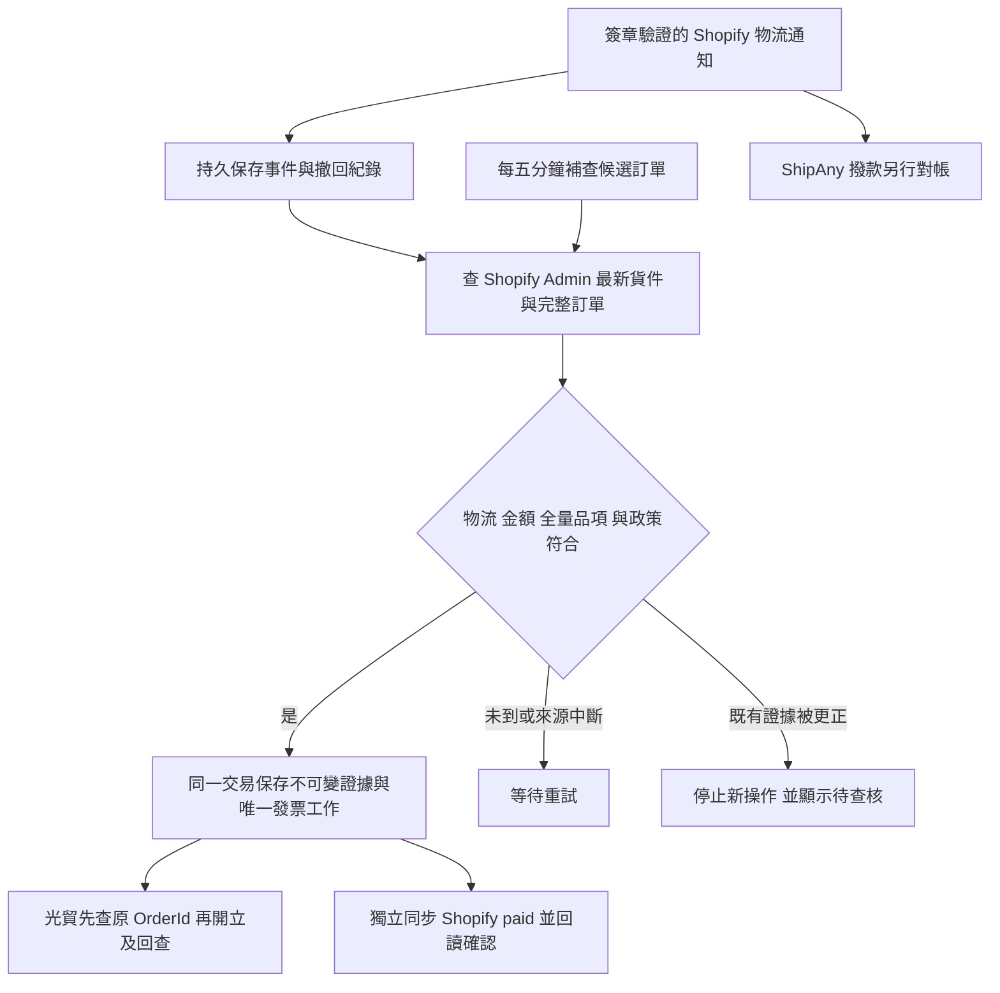

# 黑貓 COD 收款後自動開票：實作與啟用條件

更新：2026-10-22（Asia/Taipei）。分支 `codex/cod-dispatch-invoicing`、[Draft PR #73](https://github.com/charlie6989/saengak_web/pull/73)。程式及隔離本機測試完成；未部署、未套用遠端 migration、未改 Flow／正式設定、未建立外部訂單或發票。

同日後續已完成 [ShipAny／CARE 後台欄位查核](SHIPANY_COD_LIVE_VERIFICATION.md)：黑貓規則、草稿匯入及送達回寫設定已讀回；CARE 沒有已出貨實單，使用者亦確認尚無真實黑貓 COD 訂單。COD 額是獨立可編輯欄位，金額映射與修改控制仍未成立，不能開啟 amount mapping verified 或背景開關。現行送達 → paid Flow 仍作用中，首單交運前須安排切換。

## 業務依據與實作範圍

ShipAny 10/22 15:59 [書面回覆](https://mail.google.com/mail/#all/1a162a0033a0f79f)確認 CARE 黑貓常溫 COD 的 Shopify DELIVERED 代表已收足**該託運單指定代收款**並完成取件。沒有獨立收款 API，也不自動寫 Shopify paid。新實作採此服務契約推導，保存 `amountBasis=contract_inferred`；沒有虛構實收金額或付款時間欄位。

第一階段只支援 CARE、非測試、純 COD、TWD 整數、單一有效履約／單一託運單、全量實體商品、整筆應收。部分付款、退款、取消、分包裹、非已驗證物流服務均不自動開票。未送達自動補查；證據已成立後若變動則保留查核狀態。正常流程不需逐單核准、人工標記付款或匯入檔案。

## 實際程式

- `api/_lib/cod-collection.ts`：精確服務／物流公司／shipping code allowlist；核對總額、折扣、運費、未付餘額、訂單品項與履約全量品項。任何分頁未讀完均拒絕；不以配送名稱「標準」單獨判定。指紋不包含 paid 或 updatedAt，因此正常付款／物流投影更新不會改寫原證據。
- `api/webhooks/shopify.ts`：新增 `fulfillment_events/create`、`fulfillment_events/delete`；保留原訂單／退款處理。raw-body HMAC、商店限制、1 MiB body limit、合法 ID；事件持久保存成功才回 200，再透過 `waitUntil` 喚醒處理。通知本身不授權開票，仍須 Admin 即時回讀。
- `api/_lib/cod-collection-runner.ts`：保存證據、建立發票工作後，付款同步另取 lease／回讀／最後 DB 放行／`orderMarkAsPaid`／回讀確認。若外部付款請求逾時，重試先觀察是否已 PAID，避免第二筆付款。付款同步失敗不取消已保存的發票工作。
- `api/invoice/cod-collection.ts`：worker token／CRON_SECRET 保護的自動補查；每次最多 10 單，20 秒內可開始下一單，函式最長設定 60 秒。DB 保留下一次檢查時間，claim 後中斷五分鐘可恢復。實際處理量及外部 API 延遲仍須壓測。
- `api/invoice/guangmao.ts`：首次開立前再次回讀物流、比較證據、刷新檢查時間，再取得既有 DB mutation fence。沿用固定 `S<Shopify Order ID>`、provider 先查後開／回查、取消退款流程。已接受但結果未知者只查原結果；不因新的證據門檻重新開票。Edge worker 不首次開立 COD，只允許既有 provider 結果恢復。
- `api/invoice/cod-dispatch.ts`：保留管理員驗證的 GET 狀態；舊 POST 一律 410。`CodCollectionPanel.tsx` 取代舊人工核准畫面，只查詢代收款、發票、付款同步及異常原因。
- 新 migration `20261022000000_cod_collection_invoicing.sql` 演進舊設計，不改舊 migration。原手動確認 RPC 退役；原有已接受工作的 provider 查回能力保留。

## 持久化與競態

`private.cod_collection_evidence` 保存不可變證據、發票快照、查核時間與付款 lease；`cod_collection_checks` 保存補查與錯誤；`cod_fulfillment_events`／`cod_fulfillment_receipts` 保存最小事件與去重資訊，沒有保存原始顧客 webhook。皆僅 service role 可存取。

- 以訂單共用 advisory lock 序列化證據、付款最後放行、開票最後放行、取消與改單；同一訂單／履約／託運號不能重複建立證據，唯一 outbox 不換 OrderId。
- delete 先於 create 仍保留撤回紀錄；同一貨件的 delivered 被刪除，即使 Shopify 暫時仍回傳 DELIVERED 也拒絕建立證據。已存在證據設為 sticky review，不會因舊 create 重送而解除。
- 發票內容改變後再改回，仍保持查核。一般 paid／updatedAt 更新不觸發此內容變更規則。
- 首次發票 mutation 需要 60 秒內的 live verification，付款 lease 為 2 分鐘。這些是技術互斥／新鮮度門檻，沒有舊人工核准的 10 分鐘業務期限。
- 跨 Shopify／DB／光貿無法形成原子交易。最後放行後才發生的取消／改單／誤掃仍需保存真實結果並查核／作廢折讓，不能宣稱外部競態完全不存在。
- 自動告警服務尚未接入；目前可從管理頁錯誤、worker 回應與背景錯誤 log 觀察。啟用前需確認排程失敗／積壓／長期重試的監控接收人與門檻。

## 預設關閉與待啟用條件

逐單運單金額來源的後續調查與接入需求見 [ShipAny 代收額來源](SHIPANY_COD_AMOUNT_SOURCE.md)。API／Webhook 存在不代表欄位與驗簽已驗證；尚未修改下列 adapter 或門檻。

| 設定 | 預設／要求 |
|---|---|
| `COD_COLLECTION_ENABLED` | false，開啟前需完成下列驗收 |
| `COD_COLLECTION_PAYMENT_ENABLED` | false，Shopify 付款同步獨立開關 |
| `VITE_PUBLIC_COD_COLLECTION_ENABLED` | false，管理頁顯示開關，不是付款／開票權限 |
| DB `private.cod_invoice_policy.collection_enabled` | false，必須同時配置持久 `starts_at` 切換界線 |
| `COD_SHIPANY_SERVICE_ID` | 未填，需真實 `gid://shopify/FulfillmentService/...`；若 ShipAny 只回 manual／null，現有 adapter 不能啟用，須另有可靠來源識別 |
| `COD_BLACK_CAT_TRACKING_COMPANY` | 未填，需實際精確值 |
| `COD_BLACK_CAT_AMBIENT_SHIPPING_CODE` | 未填，需確認該代碼只對應已驗證黑貓常溫服務 |
| `COD_SHIPANY_AMOUNT_MAPPING_VERIFIED` | false，必須驗證下列金額映射限制，不能僅為通過程式而設定 true |
| 既有光貿 release／憑證 | 本次未改，仍須正式帳號、字軌、唯一開票來源與通知驗收 |

**金額限制：** Shopify Admin 此查詢沒有 ShipAny 的「實際託運單指定 COD 金額」。目前會核對訂單總額與全量履約，但金額本身仍依服務契約與映射不變量推導。啟用前必須在 owner system 證實訂單折扣後含運費總額確實完整帶入該運單，以及改額／手動修改的控制。如果作業允許運單金額獨立變動且沒有可信回讀，本版不能可靠判斷每筆實收，必須保持關閉並補充來源能力。

`vercel.json` 新增 `/api/invoice/cod-collection` 每五分鐘 cron，保留原發票每日一次 catchup。這只是程式設定，尚未建立正式排程；須確認 Vercel 方案支援該頻率／函式時間與費用，否則不能宣稱五分鐘自動恢復。正式排程中斷無外部監控時不保證及時開票。分支自動部署維持關閉。

正式驗收順序：

1. 核對上述物流 service／tracking／shipping code、所有品項、訂單與運單指定代收金額（含改單與分包裹拒絕情況）；取得可用且去識別的實例。不能把 mocked fixture 當成 live mapping。
2. 確認 app 訂單／履約讀取及 `orderMarkAsPaid` 權限與實際 webhook 訂閱可建立；長於 Shopify 一般 60 天訂單讀取範圍者需相應權限，讀不到會保持等待。
3. 確認會計適用性／開票時限、唯一開票來源、在途及既有發票訂單清單，選定 `starts_at`；不可清掉切換界線讓 COD 回到 paid-only 舊路徑。
4. 經正式變更授權才部署新 migration／程式、建立 webhook 與合適排程，替換現有只看「標準」名稱的 DELIVERED → paid Flow，最後啟用兩個背景開關。舊 Flow 本輪未修改。
5. 驗收真實「送達／代收 → 證據 → 光貿發票號碼 → 通知／財政部存證 → Shopify paid」，以及拒收、更正、重試、取消退款；ShipAny 撥款另表對帳。

## 本機驗證（2026-10-22）

- Vitest：62 檔、619 項通過，包括新版來源校驗、webhook 簽章／body limit／耐久保存、付款獨立重試、發票最後放行及 provider 查回。測試均使用假資料，未呼叫正式 Shopify／光貿金融操作。
- pgTAP：286 項通過（新版 COD 50 項），於本機拋棄式 `cod_invoice_tests_20261022`；正式 Supabase 及本機原始應用 DB 均未套用本次 migration。副本還原的四個 `graphql_public.graphql` extension ACL 缺項與本測試無關；11 組測試完整 rollback。
- 10 項真實 PostgreSQL 多連線競態通過：相同／衝突證據、取消、改額、部分履約、等鎖超過新鮮度、開票後取消、相同 lease 多 worker、付款 lease 競爭、送達撤回。
- `npm run typecheck`、build、content（180 files）、Supabase 靜態檢查與 diff whitespace 通過。build 保留既有大 chunk 提示。
- 直接對 app／node tsconfig 檢查仍分別有 24／41 項既有錯誤；與 HEAD `88de2d6` 的隔離快照比較，正規化路徑／行號後無新增診斷，不能宣稱完整型別檢查零錯誤。
- Vite 7.3.6 → 7.3.7 修補既有 audit 阻擋；`npm audit --audit-level=moderate` 為 0 vulnerabilities。

驗證不是正式服務驗收，PR／遠端 CI 的最新結果以 GitHub checks 為準。
