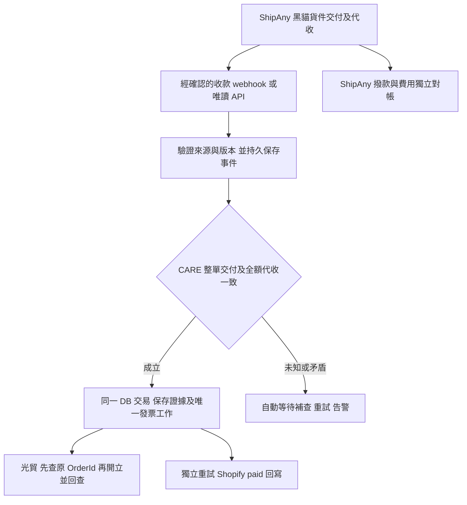

# 黑貓 COD 全自動收款後開票修改方案

日期：2026-10-21（Asia/Taipei）。狀態：**唯讀查核與待實作設計；收款來源介面、會計適用性尚未確認，不能正式啟用。**

使用者決定：ShipAny 處理黑貓 COD，客人收貨付款後由光貿全自動開票，ShipAny 匯款獨立對帳；waaship 不列入流程。不設逐單人工確認、人工標記 paid 或人工上傳對帳檔作為正常開票步驟。此方向取代出貨前人工核准；PR #73 的 `7cba3f1` 程式仍是舊實作，本次只更新方案與 PR 描述。

## 1. 查核結論與證據強度

| 問題 | 已取得證據 | 結論／限制 |
|---|---|---|
| 有一般物流 API／webhook 嗎？ | ShipAny 官方台灣物流 API 說明宣稱 REST JSON 與物流狀態 webhook，見 S1。 | 有官方能力說明；不是黑貓 COD 收款事件的 endpoint、schema 或本帳號授權證明。 |
| 有 COD 代收成功 webhook／查詢 API 嗎？ | 2026-10-16 ShipAny 人工客服回覆第 5 點：收款／對帳不提供 API 或 webhook，須後台查詢；也不自動回寫 Shopify paid，見 S2。 | 現有客服答覆不支援這條標準串接路徑。原詢問為母站全家 COD，不能無限外推為所有黑貓或客製 API 方案都沒有；本次未取得較新的黑貓專屬規格。 |
| DELIVERED 保證全額收款嗎？ | ShipAny 後台將已簽收／已到服務點對應 Shopify 已送達；COD 協議描述交付代收，但未定義 Shopify DELIVERED 的金融意義，見 S3、S4。 | **尚無足以保證的技術契約，不能單獨授權開票或確認付款。** 黑貓一般 COD 作業規則不能直接證明 ShipAny 的狀態轉譯正確且無例外。 |
| 有獨立 COD 狀態嗎？ | 後台有已創建、已收取款項、準備付款、已付、已取消，以及金額／手續費／淨額／到達時間，見 S3。 | UI 確實存在；未證實「已收取款項」是客人付款或 ShipAny 收到物流款，也未取得實收額／收款時間的 API 欄位。 |
| 能全自動接光貿嗎？ | 光貿官方有開立及按訂單編號查詢 API，現有專案已有 worker，見 S6。 | 下游技術路徑可設計；上游可信收款資料仍阻擋端到端啟用。現在不能宣稱已找到可立即上線的完整串接。 |

### S1：ShipAny 公開物流 API 說明

[台灣物流 API 全攻略](https://www.shipany.io/zho/2026/08/07/shipany-物流-api-台灣全攻略打造在地化超商物流自動化/)描述物流狀態通知、統一狀態碼與 sandbox；沒有可據以實作黑貓實收確認的公開事件名稱、金額欄位或驗證規格。文章的 sandbox 宣傳不能代替本帳號／Shopify App 的測試資格；S2 明確區別直接 API 商戶與 Shopify App 商戶。

### S2：2026-10-16 既有人工客服 Email

來源：ShipAny Customer Service，主旨「Re: LUCISSI：確認台灣 Shopify App／黑貓沙盒運單與追蹤回寫測試」，第 5 點「收款回寫與對帳」。本次唯讀既有郵件，沒有代發詢問或申請開通。

- 客服明確表示 COD 收款／結算不會自動將 Shopify 財務狀態改成 paid，建議商戶確認款項後手動標記。
- 客服明確表示此部分不提供 API 或 webhook，代收與結算明細須到「貨到付款紀錄」查詢。這個人工做法不符合本次全自動需求，不能拿來充當已完成方案。
- 原問題針對母站全家 COD；本案是 CARE 黑貓常溫 COD，需確認是否有不同的直接 API／商業方案，尚無其可用性證據。
- 同信所說約兩週後自行申領 API 文件／金鑰，是「門市列表／選店 Widget」的回覆，**不是承諾推出 COD 收款 API**。
- 同信稱 Shopify App 商戶目前無獨立 sandbox；不能用正式假單來取代隔離驗收。

### S3：ShipAny 台灣後台唯讀觀察

來源：[貨到付款紀錄](https://portal-tw.shipany.io/payment/cod-collection)、[Shopify 串接](https://portal-tw.shipany.io/ecommerce/shopify)。共用帳號需以商店＋訂單＋貨件識別，不能只用顯示單號跨店配對。

- 「貨到付款 (COD)／收款／合約」三個分頁。COD 表格有創建時間、訂單參考編號、追蹤號碼、金額、手續費、淨額、到達時間、狀態；沒有看到獨立客人付款時間欄位，金額可能是應收，不能擅稱實收。
- 查詢區間 2026-07-21 至 2026-10-21，預設已收取款項／準備付款無資料，清除狀態篩選後仍無資料。「收款」分頁當次也無資料；不代表所有歷史期間都無交易。
- 沒有完成的黑貓 COD 實例可比對。UI 狀態不是已確認的 API enum，不能從畫面命名猜 endpoint。
- CARE Shopify 串接為建單同步草稿；履約回寫說明為物流收件後 fulfilled，配送回寫說明包括已簽收／已到服務點。fulfilled、DELIVERED、collected 與 remitted 應分別處理。
- 本次查看設定選單及追蹤設定，該頁是追蹤頁面／查詢驗證配置，未看到 COD 收款 webhook 文件。有限 UI 觀察不證明帳號所有方案都沒有 API；也未擷取內部網路端點、產生金鑰或改設定。

### S4：ShipAny 協議與黑貓規則

[ShipAny COD 服務協議](https://shipany.io/zho/shipany-貨到付款-cod-服務協議/)由後台「合約 → 條款及細則」唯讀取得：第 1、2 節描述交付時代收；第 3.4 節的服務完成涉及 ShipAny 收到快遞公司款項；第 4.2 節是代收總額對帳單；第 4.4 節是收到快遞公司全額款後才撥款。沒有保證 Shopify DELIVERED 的實收語意，也沒有定義 UI 已收取款項。

[黑貓官方代收委託協議](https://www.t-cat.com.tw/Upload/SpecialPageImages/服務報價協議事項暨代收貨款委託協議書%28建議以A3列印%29.pdf)有拒付／不足額退回規則，支持正常 COD 應收足貨款的業務原則；仍不是 ShipAny 對 CARE 黑貓狀態映射、實收金額與誤掃更正的保證，且本店適用的合約版本需確認。

### S5：現行 Shopify Flow

2026-10-21 唯讀回讀 CARE「COD 宅配送達後自動標記已付款」為作用中：`DELIVERED`＋`Cash on Delivery (COD)`＋`PENDING`＋shipping title `標準` → `Mark order as paid`，當次頁面未顯示執行紀錄。

此 Flow 未核對獨立代收紀錄、實收額或實際黑貓服務。由它產生的 paid 不能反過來當收款證據，否則是循環認證。這是待切換的現行風險，本次沒有停用或編輯 Flow。

### S6：光貿官方與目前程式

[光貿 API 文件](https://invoice.amego.tw/api_doc/)與[官方範例](https://invoice.amego.tw/api_doc/example)提供 `POST /json/f0401` 開立與 `POST /json/invoice_query`（`type=order`、`order_id`）查詢。OrderId 不可重複且最多 40 字；官方查詢文件限定發票日期 180 天內，不能將長期查不到當成未曾開票。

專案 `api/invoice/guangmao.ts` 與 `supabase/functions/amego-invoice-dispatch/amego.ts` 已有固定 OrderId、先查後開與開立後回查。需延用既有訂單映射，不能為新觸發方式換 OrderId 再開一張；本地成功憑證長期保留必要欄位。這次未呼叫正式光貿 API，也未驗證正式憑證／字軌／通知／財政部存證。

## 2. 可全自動串接的選擇與採用條件

| 優先序 | 路徑 | 啟用前必須取得 | 本次狀態 |
|---|---|---|---|
| A | ShipAny 正式 COD 代收事件 → 驗證／保存 → 自動開票 | 黑貓服務支援、事件定義、簽章或等效來源驗證、事件 ID／更正版本、實收額／幣別／時間與貨件映射、重送／補查規格 | 未取得；S2 對收款 webhook 的答覆為不提供。不能寫出虛構事件 topic。 |
| B | 正式唯讀代收 API → 定時增量補查 → 同一證據處理器 | 本帳號權限、Shopify App 建立的貨件也可讀、customer-collected 語意、分頁／更新游標／更正／限流與延遲 SLA | 未取得；S2 對此 API 的答覆為不提供。只有 UI 或手動匯出不滿足此路徑。 |
| C | 具供應商書面保證的黑貓 COD 送達事件 → 自動推導收款 | 精確服務與狀態映射保證全額收款；可驗證來源、貨件、約定 COD 金額／版本且涵蓋退回與更正；排除到店、其他承運商、非 COD、部分包裹 | 尚無保證，**現有 Flow 不符合**。若核准此路徑，資料必須標示為依契約推導，不能偽稱收到實收金額欄位。 |

推薦先爭取 A，B 可獨立運作或作 A 的漏件補查；C 僅能在上述保證與驗收齊備後採用。正式、可自動取得的逐筆對帳檔若同樣具備 customer-collected 語意、驗證與及時性，也可作 B 的替代來源，但目前沒有此能力證據。等撥款才產出的報表不符合「客人付款後及時開票」的目標。

**若 ShipAny 確認 A／B 不提供、C 不保證，目前服務組合便無法可靠達成目標。** 需要供應商增加介面，或另案評估具收款證據介面的物流契約／整合。這是供應商能力決策，不是要求營運人員每天補核准；本次未更換供應商、合約或申請付費能力。後台爬蟲及未公開內部 API 不列為正式自動開票的依據。

## 3. 預定全自動流程（不是已實作能力）

- 正常路徑不需要人工核准、點已付款或匯入檔案。延遲資料自動補查；證據未到、金額不符或修正未明時自動暫停，不能猜收款成功。矛盾無法由機器釐清時只告警並保持暫停；不宣稱所有外部異常都能零人工解決，也不把人工點選放行列為日常依賴。
- 以商店＋Shopify 訂單 GID＋ShipAny 訂單／貨件 ID＋實際黑貓 COD 服務＋託運號定位。核對整單商品、折扣、買家運費、幣別及 COD 應收版本，實收總額必須等於整單應收；比較使用整數最小貨幣單位。代收手續費／銀行淨額不扣減銷售發票。
- 保存來源事件 ID、版本、來源狀態、付款事實時間（若來源真的提供）、收到／查詢時間、證據雜湊與發票內容快照。未知值保持未知，不以查詢／到達時間冒充客人付款時間。原始憑證限制權限／保存期限，Git 不存交易個資或金鑰。
- webhook 先完成來源驗證與 durable inbox 再回成功；依官方規格防偽造／重放。重送去重但接受有效更正，不能只靠「狀態數字愈大」覆寫。輪詢以增量游標加重疊窗口、分頁、限流退避及週期補查恢復漏件。
- 已全額代收是可持久保存的事實，不受舊人工核准 10 分鐘期限限制；worker lease、外部資料新鮮度、處理延遲告警各自管理，數值依供應商 SLA 與會計時限訂定。
- 光貿開票與 Shopify paid 兩個工作由同一證據衍生，各自記錄成敗／重試。開票不必等 Shopify paid，paid 成功也不等於光貿已開票；不得宣稱跨系統原子交易。付款回寫前回查最新餘額／取消／退款／幣別，原已付不再記第二筆；遇部分付款或內容變更則自動暫停。
- 在第一個新的光貿請求前重新確認訂單內容版本、取消退款及證據撤回狀態，保留共享訂單鎖。正常物流／paid 回寫不應僅因 updatedAt 改變就誤擋。外部請求送出後的取消無法原子撤回：保存原發票並進獨立取消／退款／折讓狀態機，規則待會計確認，不能自動重開或刪除證據。

## 4. PR #73 預定修改清單

| 範圍 | 需要修改的內容 |
|---|---|
| `api/invoice/cod-dispatch.ts`、`api/_lib/cod-dispatch.ts` | 移除人工出貨核准作為開票來源；改為可信收款來源 adapter／背景查核。來源驗證依正式契約，不拿 admin/Origin 檢查代替 webhook 身分驗證。保留 CARE、非 test、黑貓整單、金額、取消退款與既有發票限制；移除 pending/unfulfilled 必要條件。具體路由名稱待介面規格確定。 |
| migration／DB | 以 receipt inbox、不可變 collection evidence／版本、訂單映射、發票快照及唯一 outbox 取代 dispatch approval。證據不得跨店／跨單重用，所有 COD enqueue 路徑（包括 legacy paid）都不能繞過。實作前查證既有 migration 是否曾持久套用；已套用的版本用新 migration 演進，不改寫歷史。 |
| 10 分鐘限制 | 移除人工核准 expires_at 作為新方案業務門檻，保留 lease、來源查核時效、處理延遲與到期告警。已送出／已存在發票只回查原結果，不能用過期或未知結果重新開票。 |
| Vercel／Edge 光貿 worker | 以 collection evidence 替換 dispatch 檢查；共用固定 OrderId、先查後開、lease／mutation fence、取消改單最後放行。兩入口保護一致；若即時來源驗證僅在 Vercel，Edge 不得首次開立 COD，只作原結果恢復。逾時後沒有足夠證據不得盲目重送。 |
| Shopify webhook／paid 回寫 | COD orders/paid 只是投影，不單獨建票；非 COD 預付流程維持。新增可重試的付款投影工作、最新 outstanding 金額檢查及來源標記；不讓由 Flow 產生的 paid 形成循環證明。 |
| 背景排程 | 現在 `vercel.json` 的發票 cron 是每日 `0 1 * * *`，不能聲稱已有分鐘級補查／恢復。需設計持久佇列喚醒、定時補查、限流／退避／告警與失敗恢復，確認平台額度及費用；頻率待 SLA 與會計時限決定，本次不改排程。 |
| 管理畫面 | `CodDispatchPanel.tsx`／`OrderList.tsx` 改為唯讀顯示配送、代收證據、開票、付款同步與撥款狀態／錯誤原因；不提供逐單人工核准作為正常路徑。撤掉先開票才交運與未履約阻擋文案。 |
| Flow（僅計畫） | 正式切換時移除現有 DELIVERED → paid 的無證據授權路徑，由新的可信收款處理器同步付款。若採 C，先取得服務保證並做獨立驗證；不能只改 Flow 名稱或加標籤。現在不修改／停用 Flow。 |
| 光貿／waaship | 沿用光貿 API，唯一開票 writer 的跨應用盤點仍為上線前提；waaship 不列為物流／發票依賴，也不要求啟用它。若帳號還有殘留自動化，未經實際盤點不能宣稱不存在。 |
| 文件／切換 | 最新方案優先，出貨核准舊實作與測試標為歷史。依訂單清單處理切換界線及在途／已付款／已開票工作，不批次重開、不以去掉 cutover 繞過證據。功能開關維持預設關閉；正式 migration、設定及部署需另案授權。 |

## 5. 驗收與阻擋事項

待實作測試：

- 只有建單、標籤、fulfilled、DELIVERED 或任何來源的 Shopify paid，均不授權無證據開票；錯店／錯貨件／錯承運商／test／非 COD／部分包裹不放行。
- 偽造簽章、重放、重送、漏事件補查、亂序、更正與撤回；同一實收證據不可重用。短收／超收／幣別不符／有部分預收者自動暫停，不套用整單全額規則。
- 交付與收款事件、paid webhook 任意先後只能建立同一工作；一般 paid／物流更新不誤擋，發票內容或應收版本變更則阻止新請求。
- 多 worker、共享訂單鎖下取消／改單／證據撤回競態；去掉人工 10 分鐘後長延遲恢復不重開。逾時、provider 成功但本地回寫失敗、超過 180 天無法查詢均不可推定未開票。
- 光貿失敗、Shopify paid 回寫失敗可獨立恢復；系統崩潰後從 inbox／outbox 繼續。排程中斷與 API 限流有告警；證據／載具資料缺失不得靜默改發票類型。
- 配送及代收實際事件、發票通知與財政部存證需另外驗收。舊版 581 Vitest／299 pgTAP／8 多連線競態是出貨核准方案的歷史結果，不代表本方案已實作或通過。新功能須更新三層測試；本次只改文件。

向 ShipAny 的技術問題（僅保存草稿，未發送）：

1. 請明確確認 CARE 的台灣黑貓常溫 COD，是否不同於 10/16 對全家 COD 回覆的「收款／對帳無 API 或 webhook」？直接 API 或付費方案有無例外？請提供官方規格，不需要代開通或建立運單。
2. 若支援，是否能讀取目前由 Shopify App 建立的貨件？需哪些權限／費用，事件名稱、查詢端點、簽章、重送／補查、資料保留、限流及 SLA 為何？
3. 是否有「客人已全額付款」的狀態、實收金額／幣別／時間、貨件 ID 與事件修正版本？後台「已收取款項」究竟是哪一方收款？金額欄是應收還是實收？
4. 黑貓 COD 映射 Shopify DELIVERED 是否書面保證全額收款？如何排除到店未取、誤掃、代理簽收、部分包裹、短收、改額、取消／退回及更正？可否取得原始承運商狀態與精確服務代碼？
5. API 專用 sandbox 能否驗證上述收款與更正事件，且不產生正式費用／派件？若無，請明確列出限制及去識別的 payload 範例；正式交易驗收另行授權。

會計待確認：本店採「客人收貨付款後開票」的適用依據、書面契約條件、開票日期／期限、來源延遲／跨期、退款作廢折讓與資料保留。[財政部問答 9702](https://www.etax.nat.gov.tw/etwmain/tax-info/understanding/tax-q-and-a/national/business-tax/invoice/NEQ3G5w)仍以買賣業發貨時開票為原則，書面約定須買受人承認才生效者才另有規定；不能把「採 COD」或使用者的營運選擇當成例外已成立。

本次範圍：文件與 PR #73 修改方案更新；未改程式、migration、正式設定、Flow、光貿或 waaship，未建立訂單／標籤／發票，未合併或部署。正式服務是否滿足上述條件仍未驗收。
